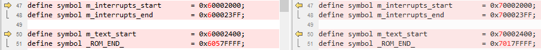

# Arm GCC

1.  Navigate to `<rt1064_install_dir>/boards/evkmimxrt1064/edgefast_open_examples/peripheral_ht/armgcc/`.
2.  Copy folder from `<rt1060evkc_install_dir>/boards/evkcmimxrt1060/edgefast_open_examples/template/` to `<rt1064_install_dir>/boards/evkmimxrt1064/edgefast_open_examples/` and rename the files.

    |**Path**|**Previous name**|**New name**|
    |`<rt1064_install_dir>/boards/evkmimxrt1064/edgefast_open_examples/`|`middleware_edgefast_open_mcux_linker_template_evkcmimxrt1060.cmake`|`middleware_edgefast_open_mcux_linker_template_evkmimxrt1064.cmake`|
    |`middleware_edgefast_open_sdio_template_evkcmimxrt1060.cmake`|`middleware_edgefast_open_sdio_template_evkmimxrt1064.cmake`|

3.  search "edgefast_open" in `<rt1060evkc_install_dir>/devices/MIMXRT1062/all_lib_device.cmake`, and add them in `<rt1064_install_dir>/devices/MIMXRT1064/all_lib_device.cmake`,such as:
    ```
	#set.middleware.edgefast_open
	#  # description: EdgeFast Open component
	#  set(CONFIG_USE_middleware_edgefast_open true)

	#  # description: EdgeFast Open BT component
	#  set(CONFIG_USE_middleware_edgefast_open_bt true)
	...
	#  # description: EdgeFast Open Controller Lwip Config component
	#  set(CONFIG_USE_middleware_edgefast_open_controller_lwip_config true)

	#  # description: EdgeFast Open Controller Wifi Config component
	#  set(CONFIG_USE_middleware_edgefast_open_controller_wifi_config true)

	${CMAKE_CURRENT_LIST_DIR}/../../middleware/edgefast_open

	include_if_use(middleware_edgefast_open)
	include_if_use(middleware_edgefast_open_asrc_sw)
	include_if_use(middleware_edgefast_open_bt)
	include_if_use(middleware_edgefast_open_bt_a2dp)
	...
	include_if_use(middleware_edgefast_open_port_shell)
	include_if_use(middleware_edgefast_open_suppressed_warnings)
	include_if_use(middleware_edgefast_open_utf8)
	include_if_use(middleware_edgefast_open_uuid)
    ```

4.  Make the following changes in the listed order.

    |File name|Previous item|New item|
    |---------|-------------|--------|
    |`config.cmake`|MIMXRT1062xxxxB|MIMXRT1064xxxxA|
    |mflash\_evkcmimxrt1060|mflash\_rt1064|
    |1062|1064|
    |evkcmimxrt1060|evkmimxrt1064|
    |`flags.cmake`|1062|1064|
    |6B|6A|
    |`CMakeLists.txt`|1062|1064|
    |`<rt1064_install_dir>/middleware/edgefast_open/middleware_edgefast_open_template.cmake`|evkcmimxrt1060|evkmimxrt1064|
    |`<rt1064_install_dir>/boards/evkmimxrt1064/edgefast_open_examples/middleware_edgefast_open_mcux_linker_template_evkmimxrt1064.cmake`|1062|1064|
    |`<rt1064_install_dir>/boards/evkmimxrt1064/edgefast_open_examples/middleware_edgefast_open_sdio_template_evkmimxrt1064.cmake`|1062|1064|

5.  Rename `MIMXRT1062xxxxx_flexspi_nor.ld` as `MIMXRT1064xxxxx_flexspi_nor.ld` and make the following changes.

    


**Parent topic:**[Migrate examples from RT1060EVKC to RT1064](../topics/migrate_examples_from_rt1060evkc_to_rt1064.md)

