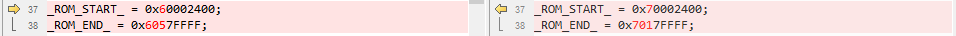
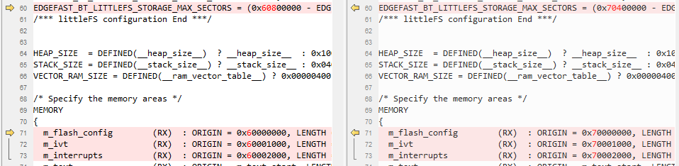

# Arm GCC

1.  Navigate to `<rt1064_install_dir>/boards/evkmimxrt1064/edgefast_open_examples/peripheral_ht/armgcc/`.
2.  Make following changes.

   	| File name      | Previous item | New item |
	| -------------- | ------------- | -------- |
	| config.cmake   | 1060          | 1064     |
	|				 | 1062          | 1064     |
	| flags.cmake    | 1062          | 1064     |
	| CMakeLists.txt | 1060          | 1064     |
	|				 | 1062          | 1064     |

3.  *mflash* is used in RT1064 instead of flash\_adapter,therefore, comment `include(component_flexspi_nor_flash_adapter_rt1064_MIMXRT1064)` in *CMakeLists.txt*.
4.  Rename `MIMXRT1062xxxxx_flexspi_nor.ld` as `MIMXRT1064xxxxx_flexspi_nor.ld` and make the following changes.

     

**Parent topic:**[Migrate examples from RT1060EVK to RT1064](../topics/migrate_examples_from_rt1060evk_to_rt1064.md)

