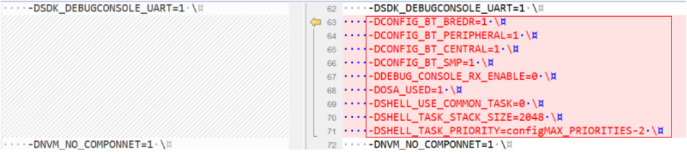

# Adjust project setting

To adjust the project settings, perform the following steps:

1.  Open the *flags.cmake* of the two examples respectively. The two files are in the *<install\_dir\>boards\\evkbmimxrt1170\\edgefast\_open\_examples\\peripheral\_ht\\cm7\\armgcc* and *<install\_dir\>boards\\evkbmimxrt1170\\edgefast\_open\_examples\\peripheral\_ht\\cm4\\armgcc* folders respectively.
2.  Search the ***CMAKE\_C\_FLAGS\_DEBUG*** section.
    1.  Compare the macro between the two sections.
    2.  Add the macros that do not exist in the **cm4** project but are available in the **cm7** project into the cm4 project. The rule is that macro setting should be same.
    3.  Delete the macros highlighted in the red rectangle.

        |

|

3.  Open the *config.cmake* of the two examples respectively. The two files are in the *<install\_dir\>boards\\evkbmimxrt1170\\edgefast\_open\_examples\\peripheral\_ht\\cm7\\armgcc* and *<install\_dir\>boards\\evkbmimxrt1170\\edgefast\_open\_examples\\peripheral\_ht\\cm4\\armgcc* folders respectively. The *config.cmake* file controls which middleware components and drivers are compiled into the project. Since the cm4 project is initially copied from *a2dp\_source*, its *config.cmake* contains middleware dependencies specific to *a2dp\_source* (such as classic Bluetooth, A2DP, AVDTP, etc.), which are incorrect for the target example. To fix this, derive the cm4 *config.cmake* from the cm7 *config.cmake* of the target example, and apply the following cm7-to-cm4 adaptations:
    1.  Replace the middleware component selections with those from the **cm7** project's *config.cmake*. For example, the *peripheral\_ht* example requires `middleware_edgefast_open_bt_hts` instead of `middleware_edgefast_open_bt_a2dp`, `middleware_edgefast_open_bt_avdtp`, `middleware_edgefast_open_bt_classic`, and `middleware_edgefast_open_libsbc`. Copy the entire middleware section from the cm7 *config.cmake* to ensure the correct components are selected. The following figure shows the middleware component differences between the *peripheral\_ht* config.cmake (left) and the *a2dp\_source* config.cmake (right). The lines highlighted in red on the right side are the *a2dp\_source*-specific components that must be replaced.

    2.  Change the core configuration at the end of the file. Replace:
        -   `set(CONFIG_CORE cm7f)` with `set(CONFIG_CORE cm4f)`
        -   `set(CONFIG_FPU DP_FPU)` with `set(CONFIG_FPU SP_FPU)`
        -   `set(CONFIG_CORE_ID cm7)` with `set(CONFIG_CORE_ID cm4)`
    3.  Replace the cache driver. Change `set(CONFIG_USE_driver_cache_armv7_m7 true)` to `set(CONFIG_USE_driver_cache_lmem true)`. The M7 core uses the ARMv7-M cache controller, while the M4 core uses the Local Memory Controller (LMEM) for cache operations.
    4.  Remove the boot header configurations. Delete the following two lines, as the M4 core does not use its own boot header:
        -   `set(CONFIG_USE_board_boot_header true)`
        -   `set(CONFIG_USE_device_boot_header true)`
    5.  Remove the MU driver. Delete the line `set(CONFIG_USE_driver_mu true)`. The Messaging Unit (MU) driver is used for inter-core communication initiated from the M7 side and is not required in the M4 project.

        The following figure shows the driver and core configuration differences between the *peripheral\_ht* config.cmake (left) and the *a2dp\_source* config.cmake (right). The lines highlighted in red on the right side are the entries that must be removed or replaced for the M4 project.

         and a2dp_source (right)")

         and a2dp_source (right)")

**Parent topic:**[Arm GCC](../topics/arm_gcc.md)

