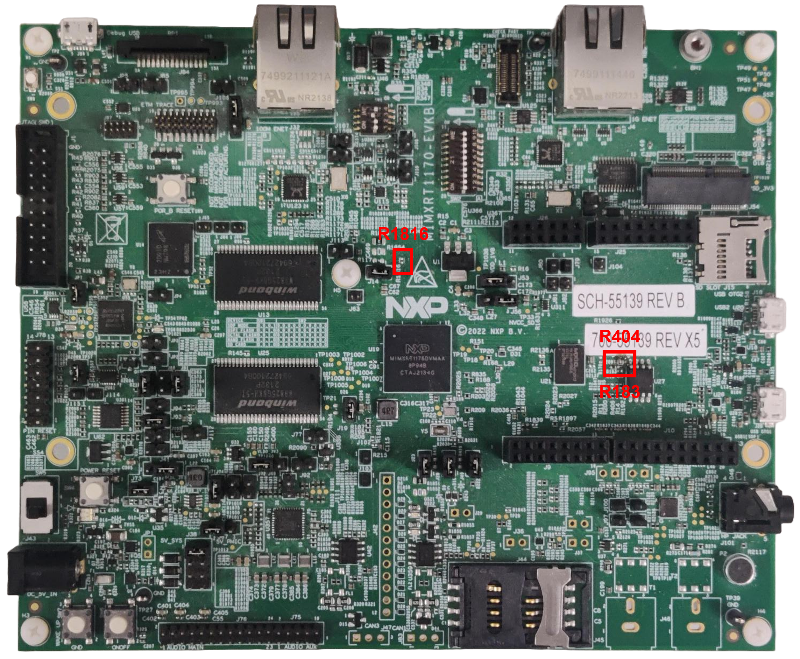
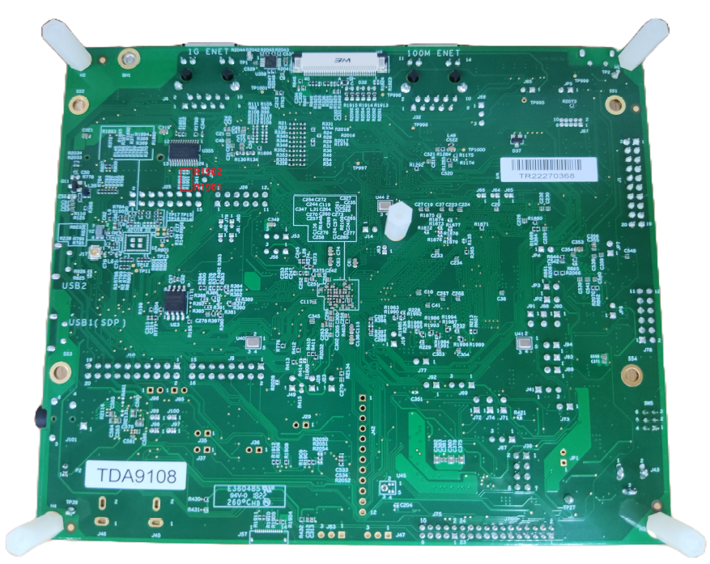
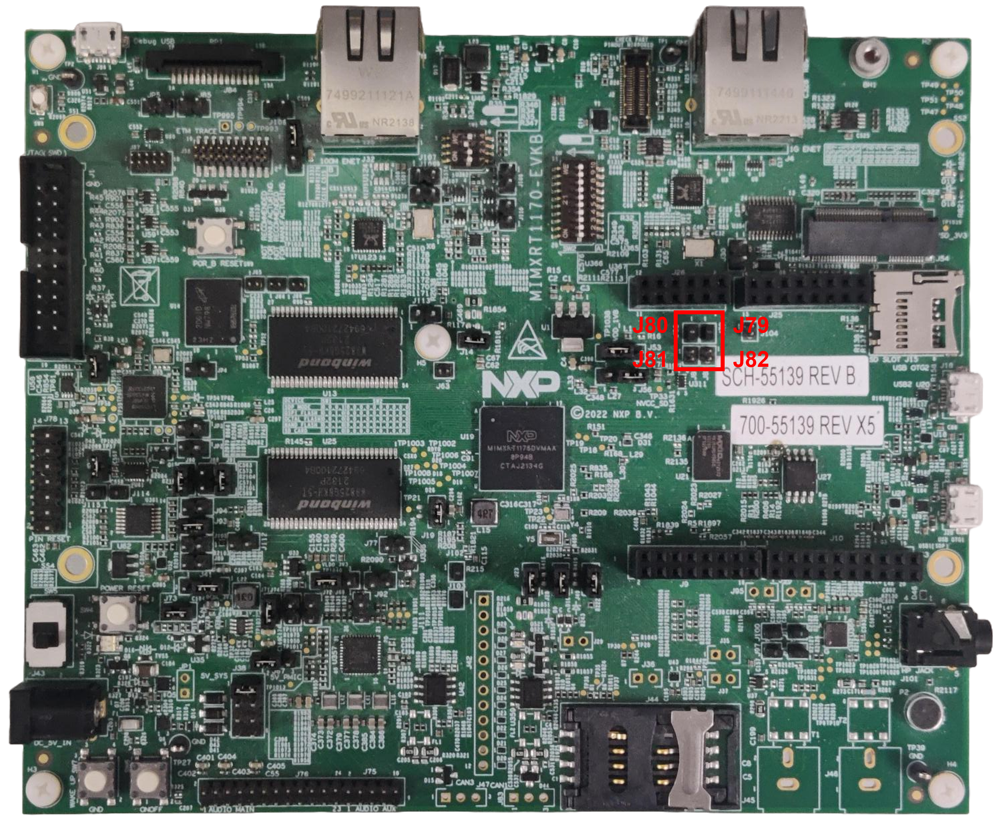
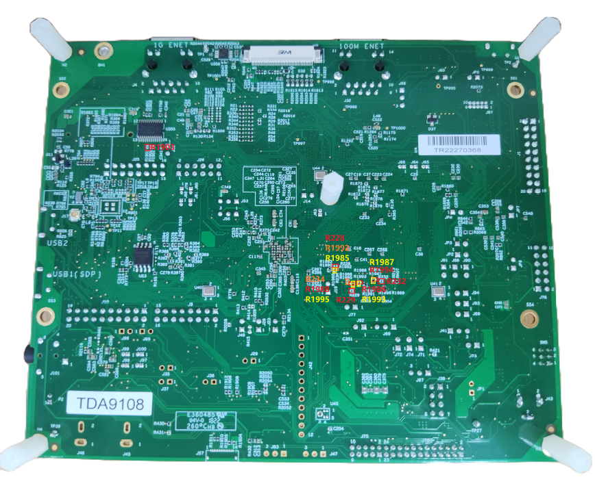

# Hardware rework

-   **HCI UART rework**
    1.  Remove resistors R183 and R1816.
    2.  Solder 0 ohm resistor to R404, R1901, and R1902.

        

        

-   **PCM interface rework**
    1.  Disconnect header J79 and J80.
    2.  Connect header J81 and J82.
    3.  Remove resistors R1985, R1986, R1987, R1988, R1992, R1993, R1994, and R1995.
    4.  Solder 0 ohm resistor to R228, R229, R232, R234, and R1903.

        

        

-   **Debug console UART missing pull-up rework (REV C1 / REV B / REV A)**

    **Note:** This rework is required for PTS (Profile Tuning Suite) testing. Without this rework, a missing pull-up resistor causes an extra `0x00` byte to appear at the start of the debug console UART data during startup.

    1.  Solder a 4.7 k&Omega;-10 k&Omega; pull-up resistor between J115 and JP6.

**Parent topic:**[Hardware Rework Guide for MIMXRT1170-EVKB and Murata M.2 Module](../topics/RT1170EVKB_Murata_M2.md)
