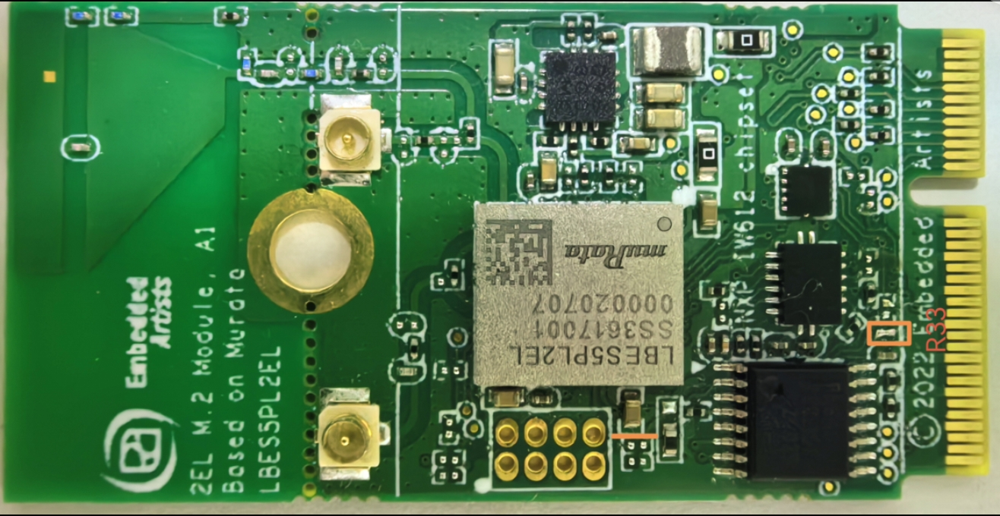

# Hardware rework

-   **HCI UART rework**

    For details, refer [Hardware Rework Guide for MIMXRT685-EVK and Murata uSD-M.2 Adapter](hardware_rework_guide_for_mimxrt685-evk_and_murata.md).

-   **Host wake-up controller pin rework:**

    1.  Solder 0 ohm resistor on R33 of the Murata 2EL M.2 Module.

        

    2.  Connect Murata’s uSD-M.2 Adapter J9 \(pin 8\) to MIMXRT685-EVK J28 \(pin 1\) with a wire.

-   **Controller wake-up host pin rework:**

    No hardware rework is required on the board. Connect Murata’s uSD-M.2 Adapter J9 \(pin 6\) to MIMXRT685-EVK J27 \(pin 8\) with a wire.

**Parent topic:**[Hardware Rework Guide for Low Power Feature on MIMXRT685-EVK and Murata 2EL M.2 Module](../topics/hardware_rework_guide_for_mimxrt685evk_with_Murata2ELM.2.md)
