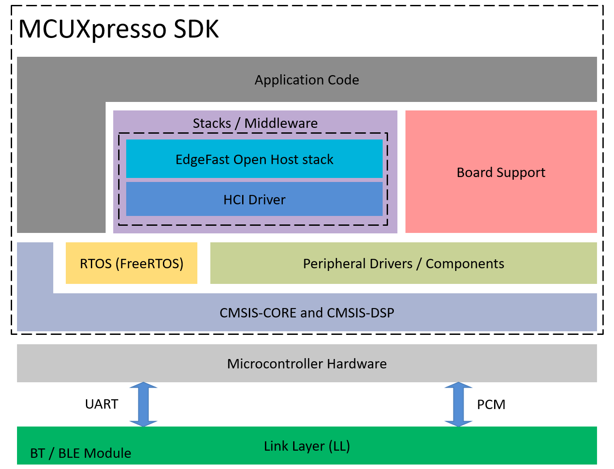

# Architecture

The figure Architecture of EdgeFast Open demo in MCUXpresso SDK below shows that the EdgeFast Open Bluetooth host stack is integrated into the MCUXpresso SDK as a middleware component. It leverages the RTOS, the board support, the peripheral driver/component, and other components in the MCUXpresso SDK. The Bluetooth application is built on top of the EdgeFast Open Bluetooth host stack and supports different peripheral features, Bluetooth features, and different RTOSes required by the user.

MCUXpresso SDK has the dual-chip architecture defined by EdgeFast Open Bluetooth project, the Bluetooth application code, and the EdgeFast Open Bluetooth host stack running on the reference board. For example, MIMXRT1060-EVK and the Linker Layer \(LL\) run on the Bluetooth modules like AW-AM457-USD, Murata Type 1XK, and Murata Type 1ZM and has single-chip architecture. Bluetooth Host stack and LL runs on the same chip, and communicate with Internal Communication Unit \(IMU\).

The communication between the host stack and the LL is implemented via the standard HCI UART interface and PCM interface for voice, or the IMU interface.

EdgeFast Open is an open-source Bluetooth Host protocol stack solution provided by NXP as part of the MCUXpresso SDK.
It is derived from the Bluetooth Host Stack of Zephyr RTOS and has been ported, tailored, and enhanced by NXP.
The stack runs on the MCU host processor, positioned below the application layer and above the HCI driver,
and is responsible for the complete Bluetooth Classic and BLE host-side protocol functionality,
including GAP, GATT, L2CAP, ATT, SM, RFCOMM, HFP, A2DP, AVRCP, etc.

Its architecture consists of two main parts:
the EdgeFast Open Host Stack itself, which contains the Bluetooth host protocol implementation ported from Zephyr,
and a Porting Layer (abstraction layer) that maps Zephyr’s required kernel and system services—such as threads,
mutexes, semaphores, queues, FIFOs, work queues, heaps, settings, shell, and logging—to the MCUXpresso SDK environment
based on FreeRTOS and NXP platforms. Through this porting layer, the originally Zephyr-oriented Bluetooth stack can
run seamlessly on FreeRTOS. EdgeFast Open communicates with the underlying Bluetooth Controller (Link Layer), typically
an external BT/BLE module or wireless SoC, via a standard HCI interface (for example, UART, SPI, or PCM).

For details about the different components in MCUXpresso SDK, see *Getting Started with MCUXpresso SDK User’s Guide* \(document MCUXSDKGSUG\) at *root/docs/Getting Started with MCUXpresso SDK.pdf*. For details on possible hardware rework requirements, see the hardware rework guide document of the relative board.
**Parent topic:**[Overview](../topics/overview.md)
