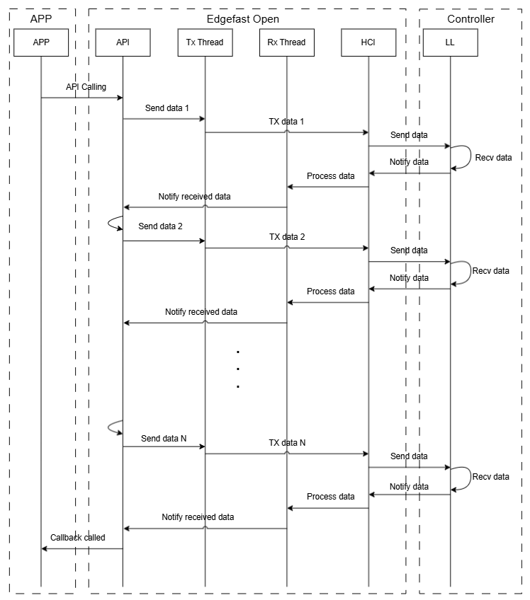
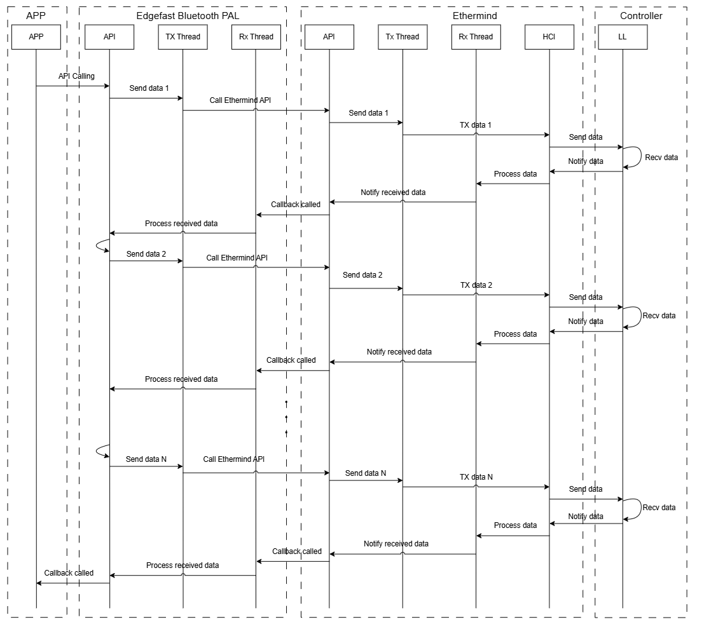

# Compare with EdgeFast Bluetooth PAL

This document provides a detailed comparison between EdgeFast Open Bluetooth Host stack and EdgeFast Bluetooth PAL, highlighting the differences in features, examples, and APIs.

## Features comparison

The following table compares the features between EdgeFast Open Bluetooth Host stack and EdgeFast Bluetooth PAL.

|**Feature**|**EdgeFast Open**|**EdgeFast Bluetooth PAL**|
|-----------|-----------------|------------------------|
|Bluetooth Core Specification|5.3|5.0|
|Bluetooth Host Stack|Zephyr-based|Proprietary with Zephyr API compatible|
|Bluetooth Controller|Supported (NXP controller)|Supported (NXP controller)|
|Mode|LE and Classic|LE and Classic|
|Protocol Support|L2CAP, GAP, GATT, RFCOMM, SDP, SM, SPP|L2CAP, GAP, GATT, RFCOMM, SM, SPP|
|Classic Profiles|A2DP, HFP, AVRCP, AVRCP Cover Art, GOEP, BIP, MAP, PBAP|A2DP, HFP, AVRCP, MAP, PBAP|
|LE Profiles|HTP, PXP, IPSP, HPS, GATT-based services|HTP, PXP, IPSP, HPS|
|Enhanced Attribute (EATT)|Supported|Supported|
|LE Audio|Supported|Supported|

## Examples comparison

The following table compares the available examples between EdgeFast Open Bluetooth Host stack and EdgeFast Bluetooth PAL.

|**Example**|**EdgeFast Open**|**EdgeFast Bluetooth PAL**|
|-----------|-----------------|------------------------|
|a2dp_bridge|Supported|Not supported|
|a2dp_sink|Supported|Supported|
|a2dp_source|Supported|Supported|
|bmr_4bis|Supported|Supported|
|bms_4bis|Supported|Supported|
|broadcast_media_receiver|Supported|Supported|
|broadcast_media_sender|Supported|Supported|
|call_gateway|Supported|Supported|
|call_terminal|Supported|Supported|
|central_fmp|Supported|Supported|
|central_hpc|Supported|Supported|
|central_ht|Supported|Supported|
|central_ipsp|Supported|Supported|
|central_pxm|Supported|Supported|
|central_tip|Supported|Supported|
|handsfree|Supported|Supported|
|handsfree_ag|Supported|Supported|
|map_mce|Supported|Supported|
|map_mse|Supported|Supported|
|pbap_pce|Supported|Supported|
|pbap_pse|Supported|Supported|
|peripheral_beacon|Supported|Supported|
|peripheral_fmp|Supported|Supported|
|peripheral_hps|Supported|Supported|
|peripheral_ht|Supported|Supported|
|peripheral_ipsp|Supported|Supported|
|peripheral_pxr|Supported|Supported|
|peripheral_tip|Supported|Supported|
|sco_bridge|Supported|Not supported|
|shell|Supported|Supported|
|spp|Supported|Supported|
|tmap_central|Supported|Supported|
|tmap_peripheral|Supported|Supported|
|umr2bms|Supported|Supported|
|umr_4cis|Supported|Supported|
|ums_4cis|Supported|Supported|
|ums_microphone|Supported|Supported|
|unicast_media_receiver|Supported|Supported|
|unicast_media_sender|Supported|Supported|
|wifi_cli_over_ble_wu|Supported|Supported|
|wireless_uart|Supported|Supported|

## APIs comparison

### Workflow

The following workflow compares the key different of API between EdgeFast Open Bluetooth Host stack and EdgeFast Bluetooth PAL.

The following diagram is a typical Egdefast Open workflow:



The following diagram is a typical EdgeFast Bluetooth PAL workflow:



### API Differences

#### Core Protocols

```{include} ../topics/compare_core_protocols.md
:heading-offset: 1
```

#### LE Profiles

No differences between EdgeFast Open Bluetooth Host stack and EdgeFast Bluetooth PAL for LE profiles.

#### LE Audio Profiles

No differences between EdgeFast Open Bluetooth Host stack and EdgeFast Bluetooth PAL for LE Audio profiles.

#### Classic Profiles

The following compares the available Classic profiles between EdgeFast Open Bluetooth Host stack and EdgeFast Bluetooth PAL.

##### A2DP

```{include} ../topics/compare_classic_a2dp.md
:heading-offset: 1
```

##### AVRCP

```{include} ../topics/compare_classic_avrcp.md
:heading-offset: 1
```

##### HFP

```{include} ../topics/compare_classic_hfp.md
:heading-offset: 1
```

##### MAP

```{include} ../topics/compare_classic_map.md
:heading-offset: 1
```

##### PBAP

```{include} ../topics/compare_classic_pbap.md
:heading-offset: 1
```

**Parent topic:**[Overview](../topics/overview.md)
