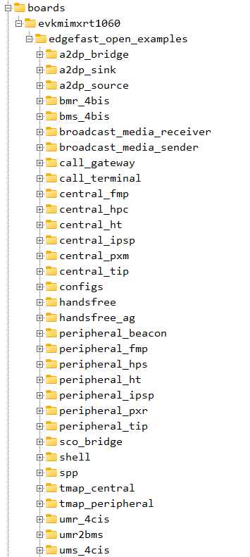
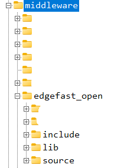

# Folder structure

The following figure shows the EdgeFast Open examples folder structure.

The following figure shows the EdgeFast Open host stack folder structure.

The following table provides information regarding the structure and description.

|**Folder**|**Description**|
|------------|-----------------|
|*boards/* *CMSIS/* *devices/* *docs/* *middleware/* *rtos/* *tools/*|MCUXpresso SDK directory. Refer to Chapter 5 Release contents of MCUXpresso SDK Release Notes at *root/docs/ MCUXpresso SDK Release Notes for EVK-MIMXRT1170.pdf* to *know the details*|
|*boards/<board\>/wireless/edgefast\_open\_examples*|EdgeFast Open Bluetooth host stack example projects|
|*middleware/wireless/edgefast\_open*|EdgeFast Open Bluetooth host stack source code|

The EdgeFast Open folder includes two subfolders:

-   **include**: This subfolder includes EdgeFast Open Bluetooth host stack headers.
-   **source**: This subfolder includes EdgeFast Open Bluetooth host stack source code ported from Zephyr Bluetooth Host stack.

**Parent topic:**[Overview](../topics/overview.md)

